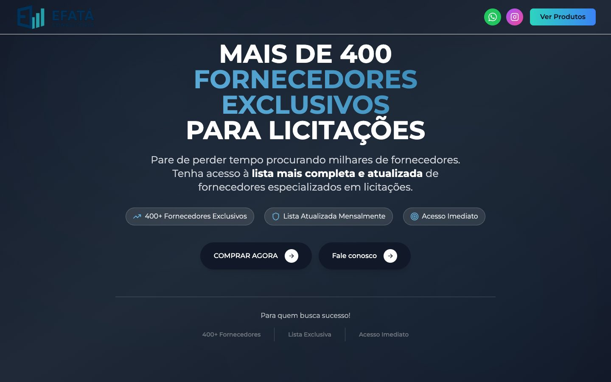
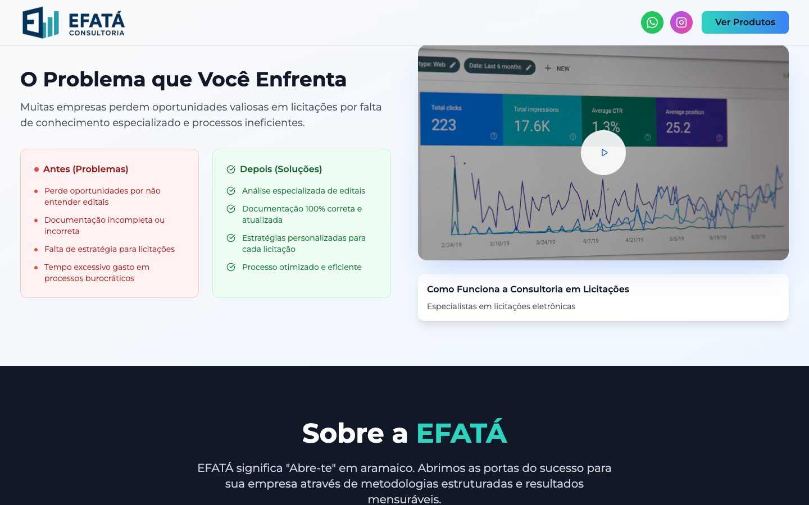
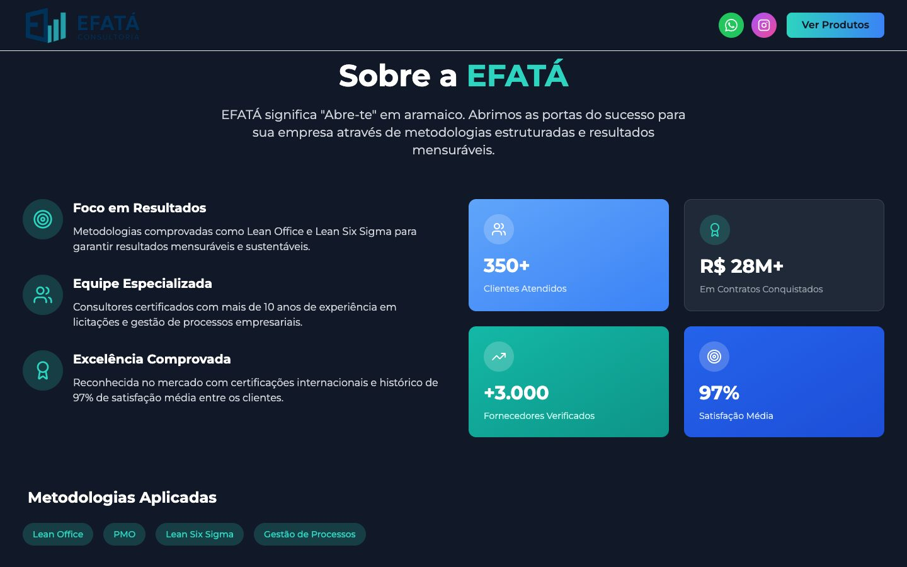
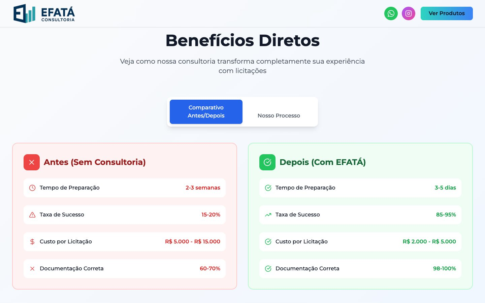
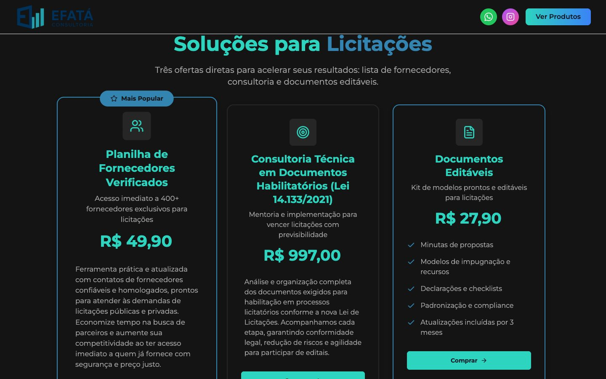
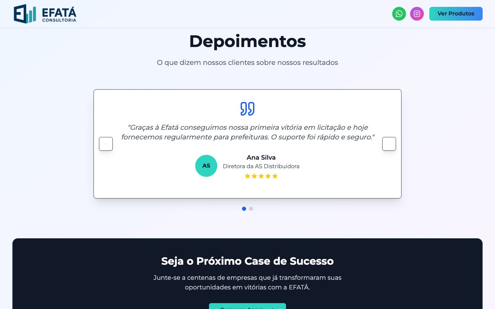
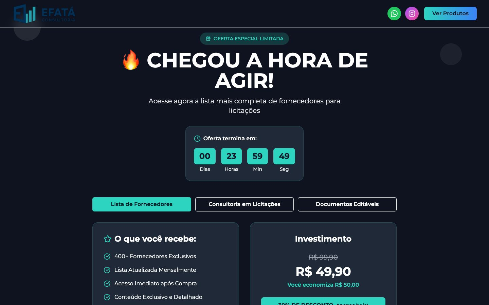
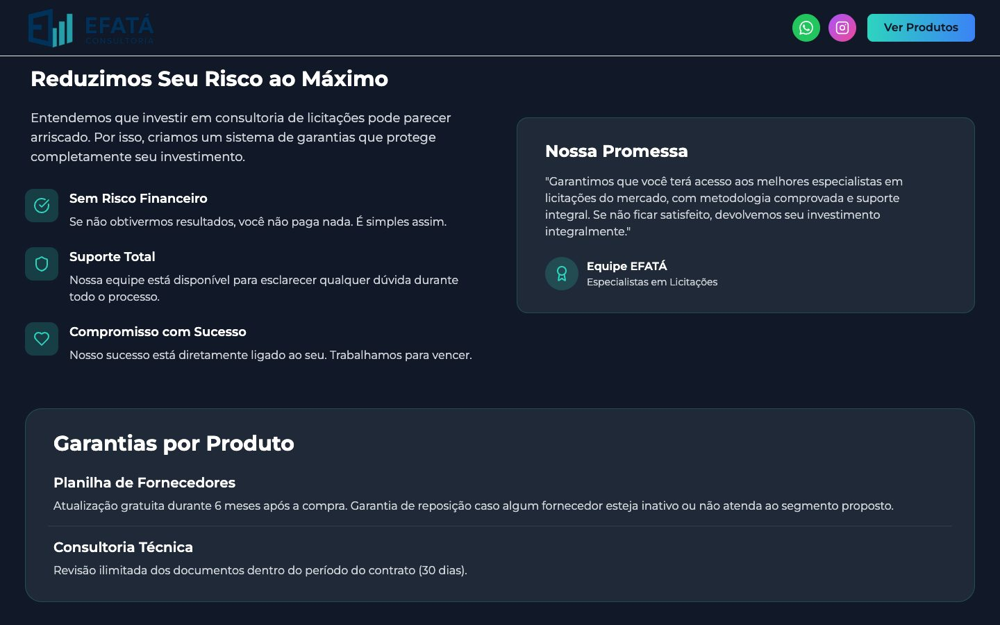
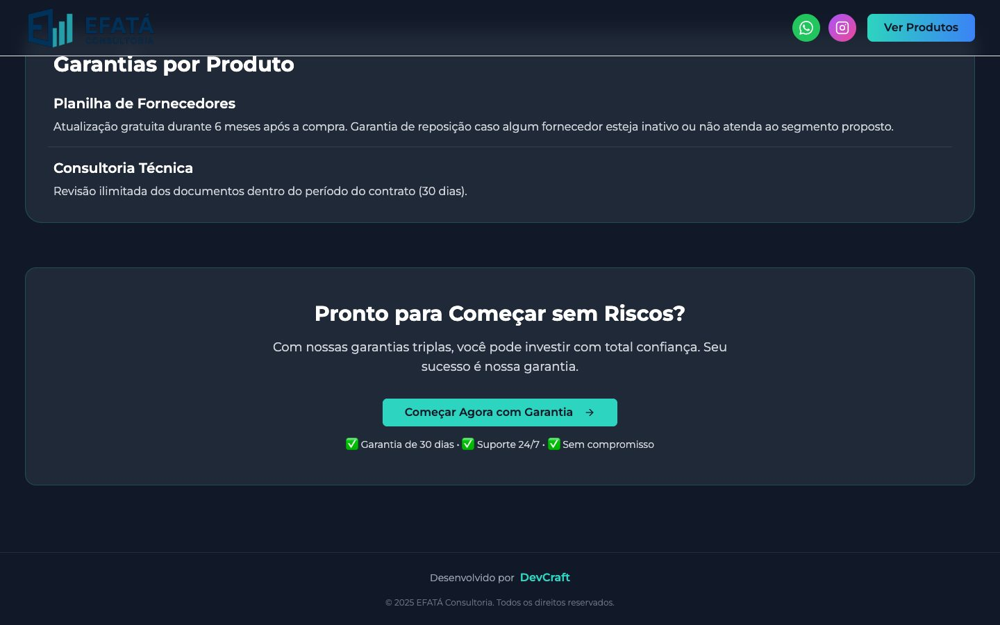
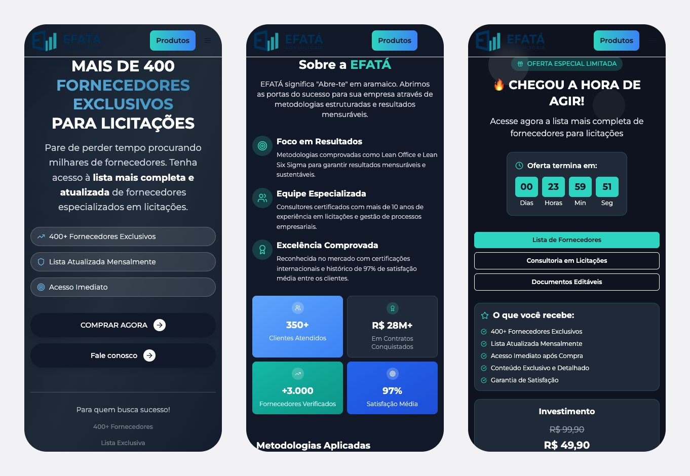

# Efatá Consultoria · estudo de caso

**Landing page de vendas para uma consultoria em licitações públicas.**
Projeto para cliente real, do briefing à publicação.

`Cliente real` · `Landing page` · `React, TypeScript e Tailwind` · `Venda pela Kiwify`

> A Efatá é uma empresa **real**. Este repositório mostra o resultado e o
> raciocínio do projeto; **o código-fonte fica em um repositório privado.**
> A versão para consulta está no [portfólio da DevCraft](https://portifolio.devcraft.dev.br/efata/).

---

## O desafio

A Efatá ajuda empresas a venderem para o poder público: analisa editais, organiza
a documentação de habilitação e indica fornecedores para quem disputa
licitações. Os produtos são vendidos online, pela Kiwify: uma planilha de
fornecedores verificados, uma consultoria técnica em documentos habilitatórios
e um kit de documentos editáveis.

A página antiga **afastava clientes por parecer golpe**. Para quem vai pagar
por uma lista ou por uma consultoria sem conhecer a empresa, essa primeira
impressão decide a venda. O site precisava:

- passar **confiança** logo na primeira dobra;
- mostrar números, metodologia e garantias antes de pedir o pagamento;
- apresentar três produtos diferentes sem confundir;
- levar o visitante com segurança até a **compra na Kiwify**.

**Pedido do cliente:** um visual **futurista e tecnológico**, que inspirasse
confiança em vez de desconfiança.

---

## Direção visual

**Escuro, tecnológico e sóbrio.** A base é quase preta, com cards em grafite,
e os azuis da marca aparecem em degradês nos títulos e nos números. As seções
alternam entre fundo escuro e claro, o que dá ritmo a uma página longa. Os
botões de compra são **turquesa**, a cor mais viva da página.

| Cor | Papel no site |
|---|---|
| Quase preto `#141414` | fundo das seções escuras |
| Azul-marinho `#002B57` | cor da marca, no logotipo |
| Azul petróleo `#3484B2` | degradês de títulos e números |
| Azul claro `#67B6E4` | destaques, links e foco |

**Tipografia:** Montserrat em todo o site, do título em caixa-alta do hero ao
texto corrido.

---

## Home

### Hero
A promessa principal em caixa-alta, "Mais de 400 fornecedores exclusivos para
licitações", com as palavras do meio em azul. Logo abaixo, três selos (400+
fornecedores, lista atualizada mensalmente, acesso imediato) e dois caminhos:
**comprar agora** ou **falar com a equipe**. O topo fica fixo, com WhatsApp,
Instagram e o botão "Ver produtos" sempre à mão.

### O problema que você enfrenta
Antes de vender qualquer coisa, a página nomeia as dores de quem disputa
licitações, num quadro de **antes e depois**: editais mal entendidos e
documentação incompleta de um lado, análise especializada e processo otimizado
do outro. Ao lado, um vídeo explica como funciona a consultoria.

### Sobre a Efatá
O nome vem do aramaico, "abre-te", e a seção usa isso como mote. Três pilares
(foco em resultados, equipe especializada, excelência comprovada), quatro
números em destaque e as metodologias aplicadas: Lean Office, PMO, Lean Six
Sigma e gestão de processos.

### Benefícios diretos
Um comparativo lado a lado, **sem consultoria × com a Efatá**: tempo de
preparação, taxa de sucesso, custo por licitação e documentação correta. Uma
segunda aba mostra o processo de trabalho.

### Soluções para licitações
Os três produtos em cards, cada um com descrição, preço e botão de compra: a
planilha de fornecedores verificados (marcada como a mais popular), a
consultoria técnica em documentos habilitatórios conforme a Lei 14.133/2021 e
o kit de documentos editáveis.

### Depoimentos
Carrossel de depoimentos de clientes e, logo abaixo, uma chamada para "ser o
próximo case de sucesso".

### Oferta
A seção de fechamento: contagem regressiva, abas para alternar entre os três
produtos e, para cada um, o que a pessoa recebe e o investimento, com o preço
cheio riscado.

### Garantias
A última objeção é o medo de pagar e não ter retorno. A página responde com
três garantias (sem risco financeiro, suporte total, compromisso com o
sucesso), uma promessa assinada pela equipe e as condições de garantia de cada
produto.

### Chamada final e rodapé
Um último convite, "Pronto para começar sem riscos?", reforçando as garantias
logo acima do botão.

---

## No celular

No celular, os selos do hero viram uma lista, os números ficam numa grade de
dois por dois e as abas da oferta se empilham.

---

## Decisões que fizeram diferença

**Credibilidade**
- Números, metodologia e garantias aparecem antes do preço.
- Garantias específicas para cada produto, em vez de uma promessa genérica.
- Quadros de "antes e depois" para tornar o ganho concreto.

**Conversão**
- Cada botão de compra leva direto ao checkout da Kiwify do produto escolhido.
- Topo fixo com "Ver produtos", para chegar à oferta de qualquer ponto da página.
- Oferta em abas, para comparar os três produtos sem sair da seção.

**Técnica**
- Painel de edição (`/cms`) para alterar os textos da página e simular métricas
  de visitas e cliques por seção, com os dados salvos no próprio navegador.
- Site estático, sem banco de dados, publicado em hospedagem compartilhada.

---

## Ficha técnica

| | |
|---|---|
| **Cliente** | Efatá Consultoria, consultoria em licitações públicas |
| **Páginas** | Landing page de vendas (página única) |
| **Front-end** | React, TypeScript, Vite, Tailwind CSS, shadcn/ui |
| **Venda** | Kiwify |
| **Hospedagem** | Hostinger |
| **Código** | repositório privado |

---

Projeto desenvolvido pela [DevCraft](https://devcraft.dev.br).
